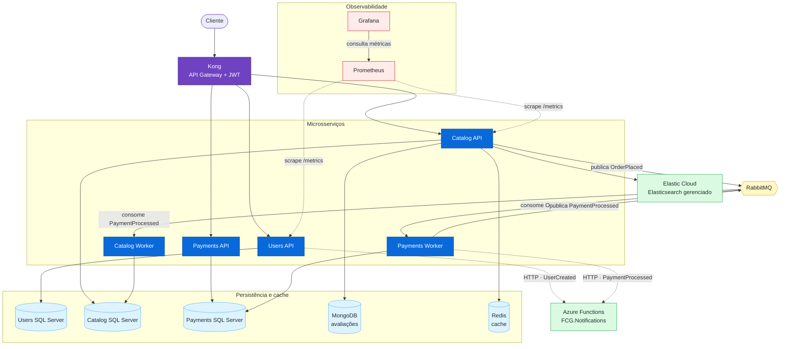

# FCG.Orchestration

Infraestrutura local e cloud, manifests Kubernetes e automação de entrega da
solução FIAP Cloud Games.

O repositório orquestra Users, Catalog e Payments, seus workers e dependências. A FCG.Notifications não é executada neste stack: ela permanece como Azure Function HTTP Trigger e é chamada por Users e Payments por meio de URL e Function Key externas.

## Arquitetura



- Kong é o único ponto público das APIs e opera em modo DB-less.
- Login e registro são públicos; as demais rotas são protegidas pelo plugin JWT do Kong.
- Users e Catalog expõem métricas para Prometheus.
- O dashboard `FCG Overview` é provisionado automaticamente no Grafana.
- RabbitMQ permanece somente nos fluxos assíncronos de Catalog e Payments.
- MongoDB armazena avaliações do catálogo e Redis fornece cache ao Catalog.
- Elastic Cloud mantém o índice de jogos usado pela busca fuzzy por relevância.
- Cada serviço SQL Server possui armazenamento persistente próprio.

## Conformidade com a Fase 4

| Requisito | Implementação |
|---|---|
| Kubernetes gerenciado | AKS provisionado por Terraform |
| Registry privado | Azure Container Registry sem usuário administrador |
| Exposição externa | Kong publicado por um único Service `LoadBalancer` |
| NoSQL obrigatório | MongoDB com PVC para avaliações do Catalog |
| Cache obrigatório | Redis autenticado para consultas do Catalog |
| Busca avançada | Elastic Cloud, indexação no Catalog e endpoint com fuzzy search |
| CI/CD mínimo | GitHub Actions para Users e Catalog; Payments também automatizado |
| Imagens versionadas | tag imutável pelo SHA e alias `latest` |
| Deploy sem downtime | rolling update dos Deployments no AKS |
| Gestão de segredos | Kubernetes Secret fora do Git; valores públicos em ConfigMaps |

Payments e Notifications excedem o escopo mínimo obrigatório da Fase 4. A Azure
Function continua sendo chamada por HTTP por Users e Payments, enquanto o
RabbitMQ permanece no fluxo assíncrono de compra entre Catalog e Payments.

## Estrutura

```text
.
├── docker-compose.yml
├── .env.example
├── kong/kong.yml
├── prometheus/prometheus.yml
├── grafana/
│   ├── dashboards/fcg-overview.json
│   └── provisioning/
├── kustomization.yaml
└── k8s/
    ├── namespace.yaml
    ├── shared-secret.example.yaml
    ├── kong.yaml
    ├── prometheus.yaml
    ├── grafana.yaml
    ├── rabbitmq.yaml
    ├── mongodb.yaml
    ├── redis.yaml
    ├── users/
    ├── catalog/
    └── payments/
```

## Ambientes e fluxo de entrega

Os ambientes usam mecanismos diferentes. O deploy manual na Azure é uma etapa
de bootstrap e validação; depois dessa validação, o fluxo oficial passa a ser a
pipeline.

| Ambiente | Infraestrutura | Implantação da aplicação | Finalidade |
|---|---|---|---|
| Local | Docker Compose | `docker compose up` | desenvolvimento e testes locais |
| Azure - primeiro deploy | Terraform cria AKS e ACR | `kubectl apply -k` após publicar as imagens | validar infraestrutura, manifests e conectividade |
| Azure - fluxo contínuo | infraestrutura já criada pelo Terraform | GitHub Actions publica no ACR e atualiza o AKS | entrega automatizada da aplicação |

O Terraform compartilhado está em [`terraform/`](terraform/) e cria somente a
plataforma Azure. Os manifests deste repositório definem os recursos executados
dentro do Kubernetes. As pipelines de Users, Catalog e Payments são responsáveis
por testar, publicar as imagens no ACR e acionar o rolling update no AKS.

Cada pipeline publica uma tag imutável com o SHA do commit e também atualiza o
alias `latest`. O deploy do serviço usa o SHA para manter a rastreabilidade. Os
manifests do Orchestration usam `latest` com `imagePullPolicy: Always`, evitando
que uma reaplicação da orquestração restaure versões antigas das aplicações.

O deployment do Elastic Cloud é um serviço gerenciado externo e não é criado por
este Terraform. Seu endpoint e sua API Key são injetados no Catalog pelo Secret
`fcg-shared-secret`, sem valores sensíveis nos manifests versionados.

Não use arquivos `.env` locais como fonte de configuração da Azure. No cluster,
configurações não sensíveis vêm de ConfigMaps e credenciais vêm de Kubernetes
Secrets ou de um gerenciador de segredos.

## Docker Compose

Crie o arquivo local de configuração e substitua todos os exemplos:

```bash
cp .env.example .env
```

No PowerShell:

```powershell
Copy-Item .env.example .env
```

Os valores críticos são `JWT_SECRET`, as credenciais de RabbitMQ, SQL Server, MongoDB, Redis e Grafana, além de `NOTIFICATIONS_BASE_URL` e, quando exigida pela Function, `NOTIFICATIONS_FUNCTION_KEY`. O mesmo segredo JWT deve ser usado pelas APIs e pelo Kong. O arquivo `.env` não é versionado.

Valide e inicie:

```bash
docker compose --env-file .env config
docker compose --env-file .env up -d
docker compose ps
```

Para encerrar sem apagar volumes:

```bash
docker compose down
```

### Acessos locais

| Componente | Endereço | Exposição |
|---|---|---|
| Kong/API Gateway | `http://localhost:8000` | público |
| Grafana | `http://localhost:3000` | somente localhost |
| Prometheus | `http://localhost:9090` | somente localhost |
| RabbitMQ Management | `http://localhost:15672` | somente localhost |
| Users SQL Server | `localhost,1435` | somente localhost |
| Catalog SQL Server | `localhost,1436` | somente localhost |
| Payments SQL Server | `localhost,1437` | somente localhost |
| MongoDB | `localhost:27017` | somente localhost |
| Redis | `localhost:6379` | somente localhost |

Users, Catalog e Payments não publicam portas próprias no host. Todo tráfego HTTP das APIs deve entrar pelo Kong.

### Rotas no Gateway

Rotas públicas:

- `POST /api/v1/auth/login`
- `POST /api/v1/users/register`

Rotas protegidas por JWT:

- `/api/v1/users`
- `/api/games`
- `/api/purchases`
- `/api/v1/games`
- `/api/payments`

Use no header `Authorization: Bearer <token>` o token emitido pelo Users. O `iss` esperado é `FCG.Users.Api`, e o segredo HS256 deve coincidir com `JWT_SECRET`.

No Kubernetes, a configuração declarativa do Kong é tratada como template. Um
`initContainer` lê `Jwt__SecretKey` do `fcg-shared-secret`, gera em memória a
credencial JWT usada pelo gateway e grava somente no volume efêmero do Pod. O
segredo real não é incluído no ConfigMap nem versionado no repositório.

### Observabilidade

O Prometheus coleta `http://users-api:8080/metrics` e `http://catalog-api:8080/metrics`. O Grafana já recebe o datasource Prometheus e o dashboard `FCG Overview`, com volume de requisições, latência p50/p95, distribuição por status HTTP e taxa de erros 5xx.

## Kubernetes

Este repositório é a fonte única dos manifests Kubernetes da solução. Os
repositórios `FCG.Users`, `FCG.Catalog` e `FCG.Payments` mantêm apenas READMEs em
suas pastas `k8s`, apontando para os manifests oficiais daqui.

Os manifests usam o namespace `fcg`, Services internos para as APIs e um único Service `LoadBalancer` para o proxy do Kong. Prometheus e Grafana permanecem como `ClusterIP`.

Crie o Secret local a partir do exemplo e substitua todos os valores antes do deploy:

```bash
cp k8s/shared-secret.example.yaml k8s/shared-secret.yaml
```

No PowerShell:

```powershell
Copy-Item k8s/shared-secret.example.yaml k8s/shared-secret.yaml
```

`k8s/shared-secret.yaml` é ignorado pelo Git e não faz parte do Kustomize. Em produção, prefira um gerenciador de segredos ou integração equivalente em vez de manter o arquivo no disco.

No primeiro deploy, aplique o Secret separadamente. Depois valide e aplique os
recursos versionados com Kustomize:

```bash
kubectl apply -f k8s/shared-secret.yaml
kubectl kustomize .
kubectl apply -k .
kubectl get pods,svc,pvc -n fcg
```

A pipeline não recria nem sobrescreve o Secret. Ela pressupõe que o
`fcg-shared-secret` já exista no namespace `fcg`.

Descubra o endereço externo do Gateway:

```bash
kubectl get service kong-proxy -n fcg
```

### Collection do Postman

A Collection e o Environment da apresentação da Fase 4 estão em
[`postman/`](postman/). Importe `FCG-Fase-4.postman_collection.json` e
`FCG-Fase-4.postman_environment.json`, preencha localmente as credenciais e
selecione `FCG - Fase 4`. Todas as chamadas externas passam pelo Kong.

O roteiro demonstra login, criação e indexação de jogo, cache miss/hit no Redis,
busca fuzzy no Elastic Cloud, avaliação no MongoDB e o fluxo adicional de
pagamento. Consulte [`postman/README.md`](postman/README.md) antes da gravação.

Acesse as ferramentas internas por port-forward quando necessário:

```bash
kubectl port-forward service/grafana 3000:3000 -n fcg
kubectl port-forward service/prometheus 9090:9090 -n fcg
```

Para remover os recursos declarados:

```bash
kubectl delete -k .
```

Esse comando também remove os PVCs do stack e, consequentemente, os dados persistidos. Revise o impacto antes de executá-lo.

## Notifications

A infraestrutura serverless da FCG.Notifications é responsabilidade do Terraform existente no repositório próprio da Function. Este repositório fornece somente a integração:

- `Notifications__BaseUrl`: hostname base da Azure Function, sem endpoint hardcoded.
- `Notifications__FunctionKey`: chave de acesso, quando a Function não estiver configurada como anônima.

Não há container, Deployment, RabbitMQ consumer nem recursos de execução da
Notifications neste repositório. O Terraform mantém somente a identidade OIDC e
as permissões mínimas usadas pelo pipeline serverless.

O deploy oficial da Function pertence ao repositório `FCG.Notifications`. Após o
bootstrap manual, pushes na `main` aplicam o Terraform e publicam o pacote sob
aprovação do GitHub Environment `production`. O Orchestration consome apenas a
URL e a Function Key resultantes.

## Imagens dos serviços

- `acrfcgfase41htwn9.azurecr.io/fcg-users-api:latest`
- `acrfcgfase41htwn9.azurecr.io/fcg-catalog-api:latest`
- `acrfcgfase41htwn9.azurecr.io/fcg-catalog-worker:latest`
- `acrfcgfase41htwn9.azurecr.io/fcg-payments-api:latest`
- `acrfcgfase41htwn9.azurecr.io/fcg-payments-worker:latest`

As pipelines também publicam a mesma imagem com o SHA completo do commit para
auditoria e rollback.

## Pré-requisitos

- Docker Engine com Docker Compose v2 para execução local.
- Cluster Kubernetes com provisionador de volumes e suporte a Service `LoadBalancer` para o deploy Kubernetes.
- `kubectl` com suporte a Kustomize.
- Azure Function FCG.Notifications previamente publicada e acessível pelos serviços chamadores.
